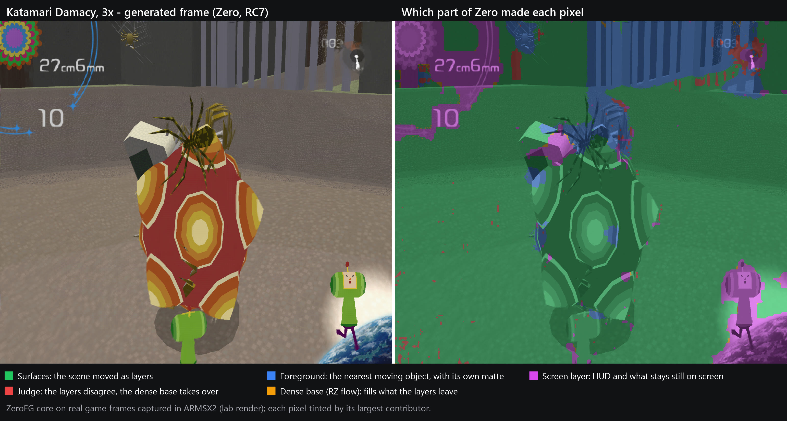
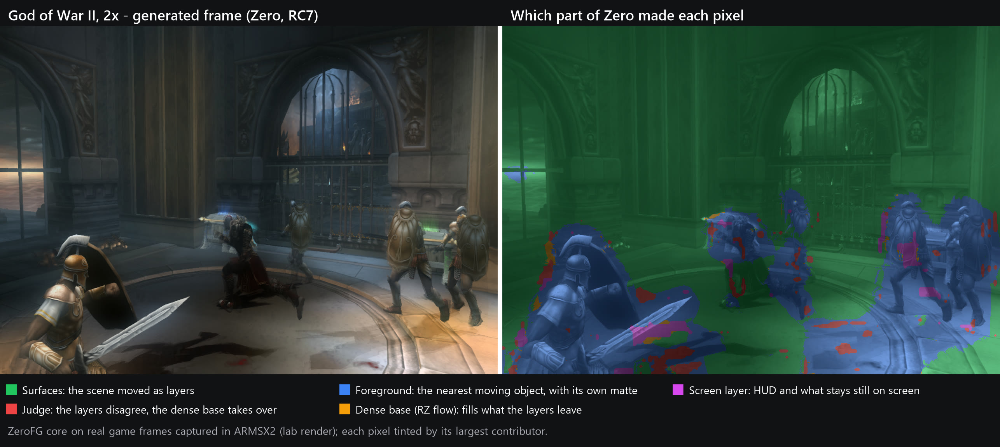
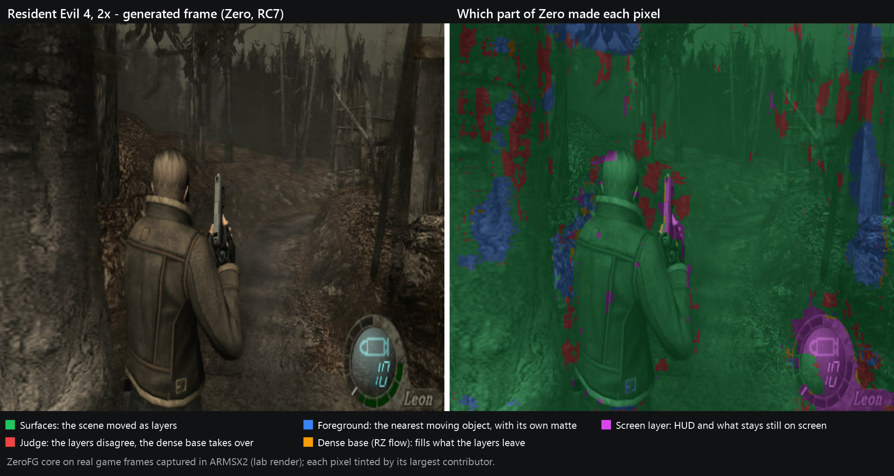

# ZeroFG

> Frame generation for mobile GPUs, built on Vulkan. **Version 1.1.0.**

ZeroFG takes two frames a game rendered and creates the one halfway between
them. Shown in between, those frames double the frame rate: 60 fps becomes
120, 30 becomes 60.

This repository has everything we built to make that work on a phone:

- **the engine** (`include/`, `src/`, `shaders/`): records the GPU work that
  generates a frame into a command buffer you give it. It owns no queue and no
  timing, so it fits into any Vulkan host;
- **the presenter** (`host/presenter/`, the ZeroFG Independent Presenter): the
  part that turns the engine into frame generation on a real device. It captures the game's frames,
  paces generation, keeps real frames in order and presents on the screen
  without ever slowing the game. This is where most of the work went;
- **the integration notes** ([INTEGRATION.md](INTEGRATION.md)): how to bring
  ZeroFG into your own host, step by step.

ZeroFG was born inside [XenDroid-ZeroFG](https://github.com/hy300leosquizz-ctrl/XenDroid-ZeroFG),
an Xbox 360 emulator for Android, where it runs in play at 120 frames per
second. It was built there, not for there: the engine has no idea it is inside
an emulator.

## The two engines at a glance

| | Zero (`Mode::kZero`) | ReallyZero (`Mode::kReallyZero`) |
| --- | --- | --- |
| What it is | Layered: surfaces, the nearest moving object and a screen layer, judged against a dense-flow picture | Dense optical flow, coarse to fine, with a cleanup where the flow doubts itself |
| Best at | The camera moving through the scene | The lowest cost; close to Zero wherever the camera holds still |
| Shaders | 44 of its own, ReallyZero's 10 (its base) and the crop | 10 and the crop |
| GPU dispatches per generated frame | 147–213 (24–30 of them indirect) | 36 (1 indirect) |
| Distinct pipelines per frame | 62–71 | 10 |
| Adreno 840, ms per frame (640 x 448 · 1280 x 896 · 1920 x 1344) | 2.18 · 3.37 · 6.42 | 0.45 · 0.94 · 1.62 |
| With the HUD path (`HudPlanes`) | 3 more shaders, 4 more dispatches | 3 more shaders, 3 more dispatches |

The times are laboratory measurements of the generation alone, on real game
frames (God of War II), with the phone's own driver. On the same phone and
harness, LSFG 3.1's performance shaders (fp16) take 0.94 · 1.12 · 1.44 ms at
their automatic flow scale and 0.95 · 2.20 · 4.15 ms at full flow.
Dispatches and pipelines were counted on every command the engine recorded
(Final Fantasy XII at 1024 x 896, 14 pairs). Zero's count moves from pair to
pair because its surface search runs in the background, a few steps per pair
under a time budget; ReallyZero's never moves.

## How the engines work

Both engines see only the two real frames, A and B, and their own history.
ReallyZero is the dense-flow picture; Zero runs all of ReallyZero as its base,
then explains the pair as layers. All of it is found and composed on the GPU,
in the command buffer you pass in.

**ReallyZero**, five stages:

1. **Pyramid.** A luma pyramid of both frames. B's is kept, and reused when B
   comes back as the next pair's A (`df_down`).
2. **Flow, coarse to fine.** At each level the flow starts from the level
   above (and, at the finest levels, also from the previous pair's answer),
   then an inverse search on small patches and a densification, both
   directions at once (`df_up`, `df_patch_*`, `df_dense`).
3. **Scene cut.** A correlation test on a coarse level: across a cut the later
   frame is shown whole, never a blend of two scenes (`df_cut`).
4. **The midpoint picture.** Both frames fetched along the flow and blended,
   with every pixel's disagreement kept (`df_final`).
5. **Cleanup.** Only the tiles with a doubt within reach are listed and
   cleaned, dispatched indirectly (`df_clist`, `df_clean_t`).

**Zero**, nine stages:

1. **Preparation.** The active picture cropped; half- and quarter-size
   copies, softened copies and per-frame statistics. What was prepared for B is
   reused when B comes back as A.
2. **Dense base.** All of ReallyZero: its flow from the half-size frames, its
   picture at full size.
3. **Surfaces.** Parts of the scene that move as a whole. The first pair
   searches in full. After that, each pair refits the surfaces to its own flow
   while the search goes on in the background: sample what is left
   unexplained, try hypotheses, fit, count inliers, test against repeated
   textures. Past the flow's reach, a fast-camera search on thumbnails.
4. **Who owns each point.** The matching cost of every surface on a lattice,
   labels by jump flooding (jumps of 8, 2 and 1), and each surface's last
   fraction of a pixel.
5. **Screen layer.** What holds still on the screen (HUD, text, overlays),
   found from both frames. With the HUD path, the host's planes are added to
   that guess, never put in its place.
6. **Mattes.** Blocks, a still occluder's side, ghosts, and holes that open
   on one frame only (an occlusion, not a pop).
7. **Foreground.** The nearest moving object gets its own motion field over
   its own matte. Only the matte's points run (dispatched indirectly), with
   jump rounds, smoothing, and an unfold step that refuses a field that folds
   (fences).
8. **Render by class.** Each tile classified by the layers it holds, then
   rendered per class, the longest groups first.
9. **Judge and mix.** Where the layers contradict themselves, the region goes
   back to the dense base; then the final mix.

Both engines notice a scene cut and show the later frame whole instead of a
blend of two scenes.

### Where each part of Zero works

Each pixel of a generated frame tinted by its largest contributor, on real
game frames captured in ARMSX2: green the surfaces, blue the foreground,
magenta the screen layer, red the judge handing the pixel to the dense base,
orange the dense base itself.







Shares over 24 pairs per scene (Katamari 3x, God of War II 2x, Resident Evil
4 2x), by largest contributor:

|  | Katamari | GoW | RE4 |
| --- | --- | --- | --- |
| Surfaces | 83 % | 79 % | 84 % |
| Foreground | 6 % | 19 % | 7 % |
| Screen layer | 10 % | 1 % | 4 % |
| Judge → base | 1 % | 1 % | 5 % |

The dense base is rarely the largest contributor, but it takes part in
20-67 % of the pixels depending on the clip: it fills what the layers leave,
mostly at the edges.

## How it compares

Every number compares a generated middle frame with the true middle frame the
game rendered (hidden-middle protocol), clip by clip, against LSFG 3.1, win-fg
and ZeroFG 1.0. Each product has two settings, so the score puts the better of
Zero and ReallyZero against the better of LSFG's automatic and full flow:

| | Clips | ZeroFG ahead | Tied | LSFG ahead | Largest lead | Largest deficit |
| --- | --- | --- | --- | --- | --- | --- |
| Whole picture, step 2 | 25 | **15** | 2 | 8 | **+5.55 dB** | -0.58 dB |
| Moving pixels only, step 2 | 6 | **5** | 0 | 1 | **+5.70 dB** | -0.12 dB |
| Whole picture, step 4 (stress) | 5 | **4** | 0 | 1 | **+0.35 dB** | -0.22 dB |

win-fg is behind ZeroFG on every clip of all three tables. On the Adreno 840,
ReallyZero costs less than LSFG at full flow at every size (2.1x, 2.3x and
2.6x less) and less than LSFG's automatic flow at 640 x 448 and 1280 x 896;
LSFG's automatic flow is cheaper at 1920 x 1344.

How it was measured:

- **One ruler for everyone.** Every generator's output exported as an 8-bit
  PNG on the same pairs (15 per clip, 23 per Arkham Knight video) and scored by
  the same script: PSNR per pair, then the mean; HF/GT per pair, then the mean.
  Pairs where the recorder repeated a frame are left out.
- **HF/GT** is the picture's high-frequency energy (luma Laplacian) relative
  to the truth: 1.0 is as sharp as the truth, below 1 is softer, and above 1 is
  dirt, not detail.
- **Step 2:** A and B are two game frames apart, so the generator sees twice
  the in-game motion. The 30 fps PS2 games are also shown at step 4, four times
  the in-game motion, as a stress test.
- **LSFG** is LSFG 3.1's performance shaders in fp16, from the maintainer's
  own `Lossless.dll`, run in our lab harness (code lineage lsfg-vk → Eden →
  ARMSX2), at its automatic flow scale and at full flow (ARMSX2's default).
  **win-fg** is the open-source frame generator for Winlator on Adreno (MIT,
  [The412Banner/win-fg](https://github.com/The412Banner/win-fg)): its
  `framegen.cpp`, unmodified, in our own Vulkan host, Balanced preset; it keeps
  no state between pairs. **ZeroFG 1.0** is the previous release's engine
  (RC3). **Blend** and **Hold** are references: the average of the two frames,
  and the first frame repeated. Only the generation is measured.
- **Frames.** PS2 games captured in ARMSX2 (consecutive game frames), two Xbox
  360 clips of Batman: Arkham City captured in XenDroid, and two published 60
  fps PC gameplay videos of Batman: Arkham Knight (six windows of 33 frames,
  evenly spaced and content-blind, scaled to 1280 x 720; only numbers from them
  are shown).
- **Moving pixels.** Where the picture changes between A and B (luma
  difference above 6 levels, widened by 2 px): PSNR, and detail fidelity
  `1 - sum (Hc - Hg)^2 / sum Hg^2` on the high-pass, where 1 is the truth's
  detail in place, 0 is no detail (a soft picture) and below 0 is wrong detail.
- Quality was measured on an AMD Vega laptop: it does not depend on the GPU.

### Whole picture, step 2

PSNR (dB) / HF/GT. Bold: the best PSNR among the six generators.

| Clip | Size | Pairs | Zero | ReallyZero | LSFG auto | LSFG 100% | win-fg | ZeroFG 1.0 | Blend | Hold |
| --- | --- | --- | --- | --- | --- | --- | --- | --- | --- | --- |
| God of War II, clip A, 1x | 640x448 | 15 | 30.45 / 0.64 | **30.67 / 0.64** | 30.53 / 0.61 | 30.53 / 0.61 | 26.21 / 1.00 | 29.46 / 0.88 | 28.53 / 0.74 | 25.62 / 0.99 |
| God of War II, clip A, 2x | 1280x896 | 15 | 29.59 / 0.67 | **29.84 / 0.68** | 29.83 / 0.63 | **29.84 / 0.65** | 26.11 / 1.40 | 28.28 / 1.17 | 28.41 / 0.74 | 25.82 / 1.00 |
| God of War II, clip A, 3x | 1920x1344 | 15 | **30.09 / 0.68** | 30.03 / 0.70 | 29.98 / 0.63 | 29.92 / 0.67 | 26.00 / 1.71 | 28.39 / 1.28 | 28.29 / 0.75 | 26.15 / 1.00 |
| God of War II, clip B, 1x | 640x448 | 15 | 36.37 / 0.78 | **36.67 / 0.77** | 36.49 / 0.77 | 36.49 / 0.77 | 33.56 / 0.79 | 35.96 / 0.78 | 35.61 / 0.81 | 33.32 / 0.99 |
| God of War II, clip B, 2x | 1280x896 | 15 | 37.27 / 0.75 | **38.58 / 0.78** | 37.73 / 0.70 | 38.41 / 0.71 | 33.47 / 0.88 | 37.82 / 0.82 | 34.96 / 0.75 | 32.66 / 1.00 |
| God of War II, clip B, 3x | 1920x1344 | 15 | 38.52 / 0.70 | **39.45 / 0.70** | 37.85 / 0.66 | 39.38 / 0.65 | 33.80 / 0.96 | 38.82 / 0.78 | 35.84 / 0.70 | 33.34 / 0.99 |
| God of War II, moving camera, 2x | 1280x896 | 15 | 33.37 / 0.47 | 33.56 / 0.58 | 33.23 / 0.34 | **33.93 / 0.39** | 25.14 / 1.52 | 31.79 / 0.82 | 26.45 / 0.49 | 24.25 / 1.00 |
| Devil May Cry, 1x | 512x448 | 15 | 31.21 / 0.52 | **31.46 / 0.51** | 31.34 / 0.47 | 31.34 / 0.47 | 29.84 / 0.67 | 31.30 / 0.59 | 30.38 / 0.59 | 28.87 / 0.99 |
| Devil May Cry, 2x | 1024x896 | 15 | 30.23 / 0.49 | 30.31 / 0.52 | 30.20 / 0.43 | 30.28 / 0.45 | 28.91 / 0.76 | **30.36 / 0.59** | 29.45 / 0.58 | 28.12 / 0.99 |
| Devil May Cry, 3x | 1536x1344 | 15 | 29.66 / 0.47 | 29.62 / 0.55 | 29.61 / 0.41 | 29.65 / 0.43 | 28.48 / 0.84 | **29.70 / 0.60** | 28.94 / 0.56 | 27.68 / 1.00 |
| Devil May Cry, moving camera, 2x | 1024x1024 | 15 | 33.64 / 0.46 | 33.69 / 0.52 | 33.79 / 0.31 | 33.85 / 0.35 | 30.35 / 0.71 | **33.87 / 0.55** | 32.11 / 0.54 | 29.59 / 1.00 |
| Klonoa | 1600x1120 | 15 | 29.42 / 0.78 | **29.45 / 0.77** | 29.43 / 0.81 | **29.45 / 0.79** | 29.41 / 0.86 | 29.44 / 0.79 | 29.42 / 0.83 | 29.06 / 1.00 |
| Klonoa, moving camera, 2x | 1280x1024 | 15 | 30.24 / 0.50 | 30.09 / 0.60 | 30.15 / 0.43 | **30.25 / 0.46** | 26.78 / 1.21 | 29.57 / 0.80 | 28.00 / 0.56 | 25.51 / 1.00 |
| Katamari Damacy, 1x | 512x448 | 15 | 24.14 / 0.40 | **24.26 / 0.32** | 24.02 / 0.35 | 24.02 / 0.35 | 22.72 / 0.81 | 24.18 / 0.63 | 23.81 / 0.74 | 21.99 / 1.00 |
| Katamari Damacy, 2x | 1024x896 | 15 | 24.08 / 0.34 | 24.07 / 0.28 | 23.64 / 0.30 | 23.64 / 0.28 | 22.56 / 0.80 | **24.10 / 0.58** | 23.66 / 0.79 | 21.84 / 1.01 |
| Katamari Damacy, 3x | 1536x1344 | 15 | 23.88 / 0.30 | 23.82 / 0.26 | 23.57 / 0.27 | 23.53 / 0.24 | 22.53 / 0.77 | **23.98 / 0.67** | 23.61 / 0.80 | 21.82 / 1.00 |
| Katamari Damacy, moving camera | 512x448 | 15 | **27.80 / 0.42** | **27.80 / 0.39** | 27.60 / 0.34 | 27.60 / 0.34 | 24.02 / 0.69 | 27.66 / 0.53 | 25.11 / 0.68 | 23.22 / 1.00 |
| Resident Evil 4 | 1280x1120 | 15 | 35.01 / 0.64 | 35.50 / 0.74 | 34.57 / 0.53 | **36.08 / 0.58** | 27.60 / 1.35 | 34.40 / 0.82 | 28.90 / 0.59 | 26.49 / 1.00 |
| Resident Evil 4, village pan | 1280x1120 | 15 | **28.81 / 0.58** | 27.59 / 0.52 | 28.15 / 0.55 | 27.96 / 0.61 | 25.04 / 2.13 | 27.69 / 1.06 | 25.80 / 0.59 | 23.86 / 0.97 |
| Shadow of the Colossus | 1280x896 | 15 | 49.99 / 0.85 | 51.26 / 0.86 | 50.49 / 0.86 | **51.27 / 0.85** | 48.21 / 0.87 | 50.73 / 0.87 | 50.16 / 0.86 | 47.09 / 1.01 |
| Shadow of the Colossus, moving camera | 1280x896 | 15 | **36.67 / 0.48** | 34.32 / 0.54 | 31.12 / 0.43 | 31.10 / 0.46 | 26.73 / 1.62 | 31.30 / 1.06 | 27.38 / 0.50 | 25.59 / 0.99 |
| Batman: Arkham City, clip 1 | 1280x640 | 14 | 27.53 / 0.63 | 27.75 / 0.67 | **28.24 / 0.69** | 28.07 / 0.72 | 21.66 / 2.20 | 27.34 / 1.15 | 22.98 / 0.70 | 20.85 / 1.00 |
| Batman: Arkham City, clip 2 | 1280x640 | 14 | 27.84 / 0.83 | 29.16 / 0.86 | 29.31 / 0.85 | 29.37 / 0.88 | 25.48 / 1.56 | **29.48 / 1.05** | 27.00 / 0.87 | 24.18 / 1.00 |
| Batman: Arkham Knight, video 1 | 1280x720 | 23 | 29.34 / 0.65 | 29.60 / 0.74 | 29.51 / 0.59 | **29.74 / 0.63** | 25.51 / 1.35 | 29.50 / 0.90 | 27.58 / 0.68 | 25.97 / 1.02 |
| Batman: Arkham Knight, video 2 | 1280x720 | 23 | 33.09 / 0.75 | **34.33 / 0.83** | 33.81 / 0.71 | 34.12 / 0.73 | 26.67 / 1.33 | 33.55 / 0.89 | 28.73 / 0.74 | 26.05 / 0.99 |

- **When the camera moves through the scene, Zero leads:** Shadow of the
  Colossus' moving camera, 36.67 dB against 34.32 for ReallyZero and 31.1 for
  LSFG; Resident Evil 4's village pan, 28.81 against 28.15 for LSFG's
  automatic flow.
- **A character over a still camera, and nearly still scenes:** the ZeroFG
  modes and LSFG are within a few tenths of a dB, and ReallyZero is the most
  often best.
- **Batman:** LSFG, ReallyZero or ZeroFG 1.0 lead Zero by 0.4-1.6 dB.
- **win-fg** is 1.5-10 dB under the others wherever something moves, with
  HF/GT above 1 (dirt) on most of those clips.
- **Every ZeroFG mode is above Hold on every clip,** and above Blend except in
  the two nearly still scenes (Klonoa, where Zero ties Blend, and the still
  Shadow of the Colossus scene, 0.17 dB under it).

### Moving pixels only, step 2

PSNR (dB) / detail fidelity.

| Clip | Moving | Zero | ReallyZero | LSFG auto | LSFG 100% | win-fg | ZeroFG 1.0 |
| --- | --- | --- | --- | --- | --- | --- | --- |
| God of War II, clip A, 1x | 10% | 20.24 / -0.18 | **20.37 / -0.17** | 20.25 / -0.08 | 20.25 / -0.08 | 16.07 / -1.07 | 19.27 / -0.61 |
| Katamari Damacy, moving camera | 93% | 27.48 / +0.13 | **27.51 / +0.13** | 27.31 / +0.13 | 27.31 / +0.13 | 23.71 / -0.18 | 27.36 / +0.14 |
| Resident Evil 4, village pan | 93% | **28.32 / -0.10** | 27.17 / -0.12 | 27.63 / -0.21 | 27.47 / -0.22 | 24.60 / -2.15 | 27.21 / -0.75 |
| Shadow of the Colossus, moving camera | 75% | **35.37 / -0.11** | 32.95 / -0.17 | 29.67 / -0.16 | 29.31 / -0.09 | 25.17 / -1.64 | 29.81 / -0.75 |
| Batman: Arkham Knight, video 1 | 64% | 26.37 / +0.09 | **26.58 / +0.06** | 26.21 / +0.15 | 26.43 / +0.19 | 22.33 / -0.71 | 26.14 / +0.02 |
| Batman: Arkham Knight, video 2 | 52% | 28.71 / +0.38 | 29.40 / +0.44 | **29.52 / +0.45** | 29.51 / +0.49 | 22.60 / -0.85 | 28.82 / +0.31 |

### Whole picture, step 4

PSNR (dB) / HF/GT.

| Clip | Size | Pairs | Zero | ReallyZero | LSFG auto | LSFG 100% | win-fg | ZeroFG 1.0 | Blend | Hold |
| --- | --- | --- | --- | --- | --- | --- | --- | --- | --- | --- |
| Katamari Damacy, 1x | 512x448 | 15 | 22.58 / 0.35 | **22.72 / 0.28** | 22.37 / 0.32 | 22.37 / 0.32 | 21.37 / 0.82 | 22.59 / 0.62 | 22.34 / 0.72 | 20.74 / 1.00 |
| Katamari Damacy, 2x | 1024x896 | 15 | 22.35 / 0.31 | 22.37 / 0.24 | 22.06 / 0.26 | 22.06 / 0.26 | 21.23 / 0.81 | **22.39 / 0.58** | 22.16 / 0.77 | 20.48 / 1.00 |
| Katamari Damacy, 3x | 1536x1344 | 15 | 22.36 / 0.30 | 22.36 / 0.22 | 22.07 / 0.24 | 22.08 / 0.23 | 21.28 / 0.81 | **22.43 / 0.68** | 22.17 / 0.81 | 20.40 / 1.01 |
| Resident Evil 4 | 1280x1120 | 15 | **31.00 / 0.60** | 30.87 / 0.70 | 30.19 / 0.51 | 30.85 / 0.57 | 25.30 / 1.71 | 29.42 / 0.96 | 26.25 / 0.58 | 24.22 / 1.01 |
| Shadow of the Colossus | 1280x896 | 15 | 46.43 / 0.81 | 47.25 / 0.82 | 46.74 / 0.79 | **47.47 / 0.79** | 44.69 / 0.85 | 46.80 / 0.85 | 46.31 / 0.81 | 44.04 / 1.01 |

### Cost

**Adreno 840, system driver, one session, outside the game.** GPU timestamps
around the generation, median ms per generated frame. Zero, ReallyZero and
win-fg ran on God of War II; LSFG and ZeroFG 1.0, whose cost does not depend on
the content, on a lab scene at the same sizes.

|  | 640x448 | 1280x896 | 1920x1344 |
| --- | --- | --- | --- |
| **ReallyZero** | **0.45** | **0.94** | 1.62 |
| LSFG auto | 0.94 | 1.12 | **1.44** |
| LSFG 100% | 0.95 | 2.20 | 4.15 |
| win-fg Balanced | 1.53 | 4.49 | 12.85 |
| ZeroFG 1.0 | 1.78 | 2.50 | 3.69 |
| Zero | 2.18 | 3.37 | 6.42 |

win-fg's other presets: Performance 0.77 / 2.08 / 5.05 ms, Quality 4.11 /
14.47 / 46.01 ms; its quality above is the Balanced preset.

**Other GPUs** (earlier sessions; ReallyZero before its last 10-13 %):

|  | Adreno 650 (S20 FE), Turnip, 640x448 / 1280x896 | Radeon Vega 10 (laptop), 640x448 / 1280x896 / 1920x1344 |
| --- | --- | --- |
| ReallyZero | 2.83 / 6.13 | 1.22 / 2.70 / 4.68 |
| LSFG 100% | 5.97 / 15.37 | 1.38 / 4.31 / 8.89 |
| LSFG auto | 6.59 / 6.98 | 1.39 / 2.13 / 3.19 |
| ZeroFG 1.0 | 6.08 / 9.65 | 4.10 / 6.78 / 11.00 |
| win-fg Balanced | – | 2.56 / – / – (2026-10-28) |

### The HUD path

A host that sees how the game draws its HUD can hand it over (`HudPlanes`,
[INTEGRATION.md](INTEGRATION.md#4b-the-hud-optional)). The HUD that holds still
is lifted off both frames, the scene is generated without it and the newer HUD
goes back on top; the HUD that changes stays in the pictures, where Zero's
screen layer holds it in place. ARMSX2's ZeroGS mode draws the planes from the
PS2's GS. Up to **+0.54 dB** on the whole picture and up to **+6.2 dB** on the
HUD.

Whole picture: PSNR (dB) / HF/GT. HUD: PSNR on the true frame's HUD pixels
only. Step 2, 14 pairs per clip.

| Clip | Size | HUD share | Zero | ZeroGS | Zero, HUD | ZeroGS, HUD |
| --- | --- | --- | --- | --- | --- | --- |
| Final Fantasy XII | 1024x896 | 14.2 % | 34.83 / 0.70 | **35.37 / 0.71** | 32.48 | **33.80** |
| Dirge of Cerberus | 1280x1120 | 3.8 % | 34.04 / 0.91 | **34.34 / 0.95** | 30.08 | **35.15** |
| God of War | 1280x1120 | 5.0 % | 31.53 / 0.76 | **31.54 / 0.77** | 41.36 | **47.38** |
| Shadow of the Colossus | 1920x1344 | 2.2 % | **37.43 / 0.90** | 37.42 / 0.90 | 52.55 | **58.75** |
| Spider-Man 3 | 1600x1120 | 1.1 % | **36.23 / 0.64** | 36.22 / 0.64 | 39.77 | **41.96** |
| SoulCalibur II | 1600x560 | 8.6 % | 21.51 / 0.73 | **21.57 / 0.74** | **18.37** | 18.32 |
| Katamari Damacy | 512x448 | 10.4 % | 26.19 / 0.46 | **26.23 / 0.46** | 25.41 | **25.49** |
| Resident Evil 4 | 1536x1344 | 3.4 % | 38.27 / 0.71 | **38.28 / 0.71** | **46.18** | 45.67 |
| Crash Tag Team Racing | 1600x1120 | 8.0 % | **33.35 / 0.60** | 33.31 / 0.60 | 30.83 | **30.90** |
| Klonoa 2 | 1280x448 | 1.7 % | **28.54 / 0.85** | 28.53 / 0.85 | **18.42** | 18.38 |
| Devil May Cry 3 | 512x256 | 2.1 % | **34.20 / 0.89** | 34.17 / 0.89 | **18.96** | 18.91 |

- **Where it matters:** a HUD the camera moves under (FF12's party panel and
  minimap, Dirge of Cerberus' ammo panel, God of War's health bars, Shadow of
  the Colossus' HUD). Without the HUD path the generator drags the world into
  the HUD and the HUD into the world.
- **Where it does not:** an animated HUD (Katamari's prince, Crash's counters,
  Klonoa's and Devil May Cry's gauges) changes between the two frames, so it
  stays with the generator.
- **Cost:** 0.2-0.3 ms more for Zero on the Adreno 840, plus, in the game, one
  copy of the planes to ZeroFG's device with each frame.

### What these numbers do not say

- **Nothing about LSFG inside ARMSX2 or in the Lossless Scaling app, or win-fg
  inside Winlator.** Only their generation was measured, in our hosts.
- **Nothing about PSNR as the final judge.** PSNR rewards a soft picture: a
  sharp detail a fraction of a pixel off costs more than no detail. Several
  cases were closed by eye against the number.
- **Nothing about single-frame defects over time.** These tables score each
  pair alone.
- **Nothing about other phones.** Three GPUs were measured.

## The presenter

The ZeroFG Independent Presenter is unchanged since 1.0.4, apart from the
scene-cut mark (`content_break`): it carries the mark with the frame and
generates nothing across it. Its numbers are still those measured in play on
the Adreno 840:

| Measurement | Before | After |
| --- | --- | --- |
| PPSSPP, Naruto at 30 -> 60: refreshes per frame | uneven 1-3 | an even 2 · 2 (1.0.4) |
| ARMSX2, Resident Evil 4: from the game's frame to its target | | about 13 ms sooner, 0-3 % of generated frames late (1.0.4) |
| XenDroid, Arkham City under a 30 fps cap: intervals at two refreshes | 38 % | 79-89 % (1.0.4) |
| XenDroid, Arkham City with the GPU 95-99 % busy: the frame copy | 40-170 ms | 1.3 ms, ZeroFG's device at high priority (1.0) |
| XenDroid, Modern Warfare 3 capped at 40: lag, ~80 fps on screen | 70 ms | 55 ms (1.0.2) |

The [presenter's README](host/presenter/README.md) has the details, and how to
tune it for a new host.

## Requirements

- A Vulkan 1.3 device with `synchronization2` and
  `shaderStorageImageExtendedFormats` enabled.
- `A2B10G10R10_UNORM_PACK32` storage images that can be blitted from, and an
  input format that can be sampled with linear filtering (`R8_UNORM` storage
  images too for the HUD path).
- A picture from 64 x 64 to 16384 x 16384.

Optional features the device has enabled make it faster (half-precision
colour, 64-wide subgroups, cubic filtering). Every backend gives the same
logical result.

## Building the engine

```sh
cmake -S . -B build -G Ninja -DCMAKE_BUILD_TYPE=Release
cmake --build build
```

This builds the static library `zerofg` (alias `zerofg::zerofg`). The shaders
ship compiled (`shaders/prebuilt`), so a host needs no shader tools. With
Python 3, `glslangValidator` and `spirv-opt` from the Vulkan SDK (set
`VULKAN_SDK`, or put both on `PATH`) they are compiled from `shaders/`
instead; `-DZEROFG_PREBUILT_SHADERS=ON|OFF` forces one or the other. After
changing a shader, build `zerofg_update_prebuilt_shaders` and commit
`shaders/prebuilt` with it (`zerofg_check_prebuilt_shaders` fails while they
differ). The Vulkan headers come from
`find_package(Vulkan)`, or from `-DZEROFG_VULKAN_HEADERS_DIR=<dir>`; with the
Android NDK toolchain, the NDK's own headers are used. The library never links
a Vulkan loader: every entry point comes from the `vkGetInstanceProcAddr` you
pass in.

```cmake
add_subdirectory(third_party/ZeroFG)
target_link_libraries(my_host PRIVATE zerofg::zerofg)
```

Or let CMake fetch it:

```cmake
include(FetchContent)
FetchContent_Declare(zerofg
  GIT_REPOSITORY https://github.com/hy300leosquizz-ctrl/ZeroFG.git
  GIT_TAG v1.1.0)
FetchContent_MakeAvailable(zerofg)
target_link_libraries(my_host PRIVATE zerofg::zerofg)
```

Built and checked on Windows (clang, llvm-mingw) and Android (NDK r29,
arm64-v8a). The presenter builds in any Android host through
[`host/portable`](host/portable/), whose README lists what a host has to do.

ZeroFG 1.1 has been runtime-validated in games on the Adreno 840 (ARMSX2); its
engines are also timed on the Adreno 650 and a Radeon Vega in the laboratory.

## By the numbers

Two months, August to October 2026: 736 commits, more than 137,000 lines
written and 64,000 rewritten away, about 64,000 lines of original code (the
engines from RC1 to Zero, the presenter, and a laboratory that tests the engine
against ground truth) and 34,000 lines of engineering notes.

## From V1 to 1.0

V1 (August 2026) was the first engine that worked: block motion, a confidence
value and a blend. It produced real frames and strong ghosting, and it had no
presenter at all. It stays in this repository's history. 1.0 replaces all of
it: a new motion estimator verified at full resolution, a temporal prior, an
exposure model, a continuity guard, a new resolve, and the presenter, measured
against ground truth in the laboratory and in play.

## What's new in 1.1

Two new engines, under the same two names:

- **Zero is now a layered engine** (RC7): surfaces, the nearest moving object
  and a screen layer over a dense-flow picture, with a judge that takes regions
  back where the layers disagree. It leads when the camera moves: on a Shadow
  of the Colossus camera pan, 36.67 dB against ReallyZero's 34.32 and LSFG
  3.1's 31.1 (the same pairs, the same ruler).
- **ReallyZero is now a dense optical flow** with a cleanup pass: the cheapest
  ZeroFG yet (0.94 ms at 1280 x 896 on the Adreno 840), and close to Zero
  wherever the camera holds still.
- **The 1.0 engine (RC3) is retired.** `Mode::kZero` and `Mode::kReallyZero`
  now create the new engines, so a 1.0 host gets them without a code change;
  `Mode::kRC7` and `Mode::kDenseFlow` name the same engines.
- **Any picture size** from 64 x 64 to 16384 x 16384, no cell grid to fit.
- **Scene cuts.** Both engines show the later frame whole across a cut, and a
  host that knows where its cuts are can tell the presenter
  (`content_break`, see [INTEGRATION.md](INTEGRATION.md#6-pace)).
- **The HUD path** (`HudPlanes`): a host that sees how the game draws its HUD
  hands it over, and it stays crisp and in place over a moving world: up to
  6 dB more on the HUD in our PS2 measurements. ARMSX2's ZeroGS mode draws it
  from the PS2's GS ([INTEGRATION.md](INTEGRATION.md#4b-the-hud-optional)).

## What's new in 1.0.4

The engine is unchanged; this release is the presenter's pacing, from the
hosts that cannot pull their game's frames
([details](host/presenter/README.md#what-changed-in-104)):

- **Phase recovery.** A game on its own clock (an emulator's frame limiter,
  not one the host can pull) no longer drifts the output calendar away from it.
  Before, at 30 -> 60 that drift showed as uneven 1-3 refresh pairs, a
  generated frame next to its real one. The presenter now measures the game's
  period from its frame times. It brings a calendar that fell behind back to a
  small cushion above the depth it needs, and drains one far ahead through the
  rate, without skipping anything.
- **Measured** on the Adreno 840 in PPSSPP (PSP), ARMSX2 (PS2) and XenDroid
  (Xbox 360):
  - a PSP game at 30 -> 60 is back to even pairs;
  - a PS2 game shows its frames about 13 ms sooner;
  - an Xbox 360 game under a 30 fps cap went from 38 % to 79-89 % of intervals
    at two refreshes.
- **Pacing tools for hosts.** Every host differs: who sets the frame clock, the
  copy, what else is on the screen. Pacing has to be measured again on each
  one. The presenter's switches are now settings a host can change after
  measuring: phase recovery, the free output, the vsync quantizer and an
  optional tight vsync reach, which is off by default. The
  [presenter README](host/presenter/README.md#tuning-a-hosts-pacing) lists them
  with how to measure.

## What's new in 1.0.3

The engine is unchanged (the same as 1.0.2); this release is for hosts:

- **The presenter is ZeroFG's own.** The ZeroFG Independent Presenter lives in
  [`host/presenter`](host/presenter/), and [`host/portable`](host/portable/)
  stands in for the few Xenia-shaped types it includes, so the presenter, its
  egress and the device handoff build unchanged in any Android host.
  XenDroid's own integration moved to [`host/xendroid`](host/xendroid/), as an
  example host.
- **A second host: ARMSX2 (PS2).** A 60 fps game shown at 120 fps on a 120 Hz
  phone, switched on and off in game. The kit's README lists what a host has
  to do that the presenter does not tell you.
- **No Vulkan SDK needed to build.** The shaders ship compiled
  (`shaders/prebuilt`); the SDK's tools are only needed to change them.
- **A host-chosen handoff publish depth** (`SetPublishDepth`, 1 by default), for
  a Source that runs ahead of its GPU.

## What's new in 1.0.2

The engine is unchanged; this release is the reference host's pacing
([details](host/presenter/README.md#what-changed-in-102)):

- **The output follows the game's real rate.** The presenter's clock follows
  the average of the game's last frames, measured without the time the game
  spent waiting on ZeroFG, and runs a little faster while frames sit deeper
  than needed. A game that alternates 33 and 50 ms frames used to leave the
  clock stuck, with about half a second of delay in Arkham City.
- **Fewer stutters when the frame rate changes.** When the clock changes pace,
  the new timing starts where the next real frame can actually go, instead of
  leaving a slot nothing fills.
- **Guest pacing in the emulator host**: a late game frame gets its vblank at
  once, and a game frame rate cap gives a GPU-bound game's frame generation
  room to work (Modern Warfare 3 at 40: the same ~80 fps on screen, 70 -> 55 ms
  of lag). A patch to XenDroid's GPU code, in `host/xendroid/xendroid_glue/`.

## What's new in 1.0.1

- **Lower latency and a steadier cadence below 30 fps**, in the presenter:
  the presentation can run a few refreshes ahead to drain accumulated delay,
  the game's wait for its own GPU no longer counts as backpressure, and the
  pre-priority operating point is off
  ([details](host/presenter/README.md#what-changed-in-101)).
- **Any picture size.** A picture the cell grid does not divide runs padded to
  the next one it does (Halo 3, 1152 x 640); a tiled picture is bit-identical
  to 1.0.
- **A build guard** in the reference host: a driver that crashes compiling
  ZeroFG's pipelines runs Compat at the next launch, and ZeroFG turns off
  after a second crash.

## Contact

Questions, integration help and collaboration: **fgzerofg@gmail.com**.

## Development and credits

ZeroFG is developed through human–AI collaboration.

- **hy300leosquizz** ([`hy300leosquizz-ctrl`](https://github.com/hy300leosquizz-ctrl)) — creator and maintainer. Lawyer by trade, Formula 1 podcast presenter by passion, and software architect by sheer determination and curiosity, developing latent talents after asking himself whether he could modify a few features in emulators and falling down the rabbit hole for months: he drew the architecture, set the direction, had an instinct trust rate of 98%, became an expert in Vulkan and in frame generation features and capabilities, made every final call, and ran every test on his own phones, usually a hot one.
- **Zeromeia** — the project name for an AI development collaborator powered by ChatGPT by OpenAI: architecture, runtime and log analysis, experiment design, code review, documentation and release preparation.
- **Zé Raio** — the project name for an AI development collaborator powered by Claude by Anthropic: implementation, the measurement laboratory, log analysis, documentation and release preparation.

AI-generated analysis, designs, code and documentation are engineering inputs. Final decisions, device testing, validation and publication stay with the human maintainer. The names Zeromeia and Zé Raio describe the project's use of ChatGPT and Claude and do not imply sponsorship or endorsement by OpenAI or Anthropic.

## License

Licensed under the **Apache License, Version 2.0** (`Apache-2.0`). See
[`LICENSE`](LICENSE).

Three files keep Xenia's BSD 3-Clause license
([`LICENSE-Xenia`](host/xendroid/LICENSE-Xenia)): in `host/xendroid/`,
`vulkan_presenter_zerofg_device_context.inc` (adapted from Xenia's presenter)
and `xendroid_glue/vulkan_presenter_zerofg_glue.cc` (an excerpt of it); and
`host/portable/include/xenia/base/frame_stats.h`, from XenDroid's Xenia source
tree. A provenance check found no code shared with Xenia or XenDroid in any
other file.
